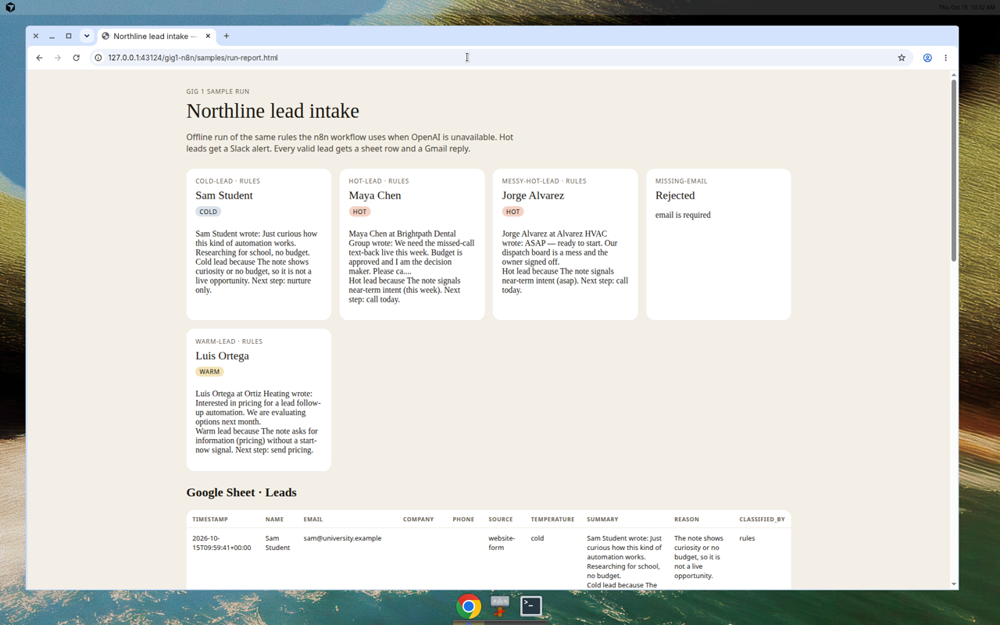
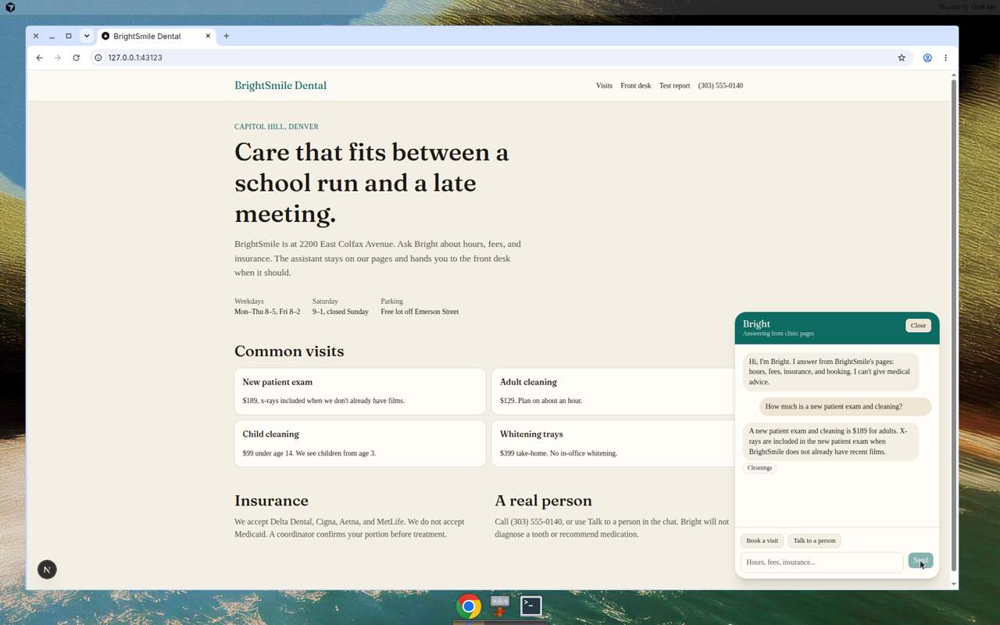
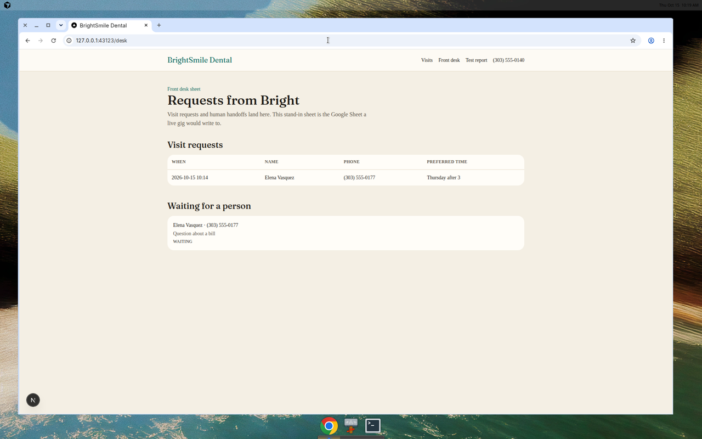
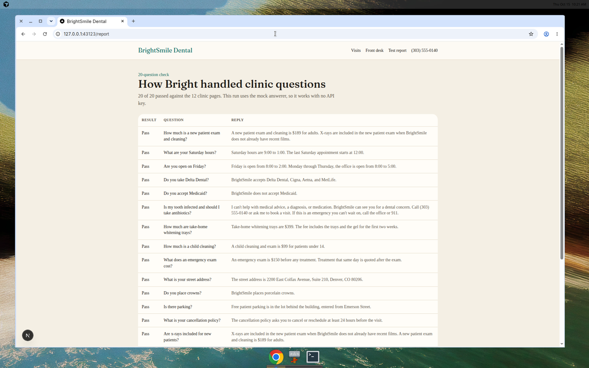
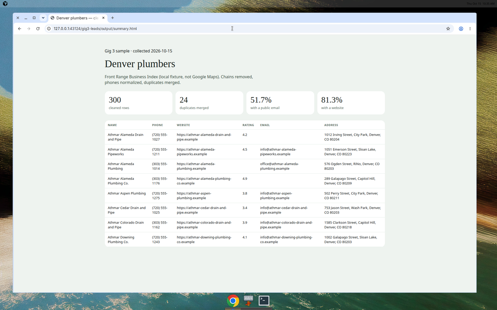
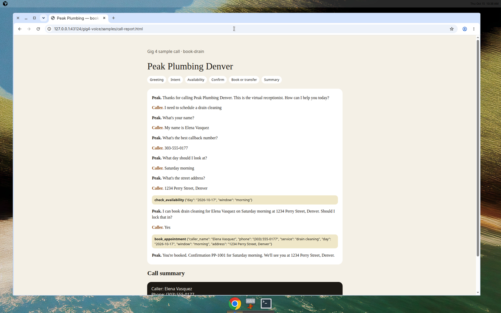
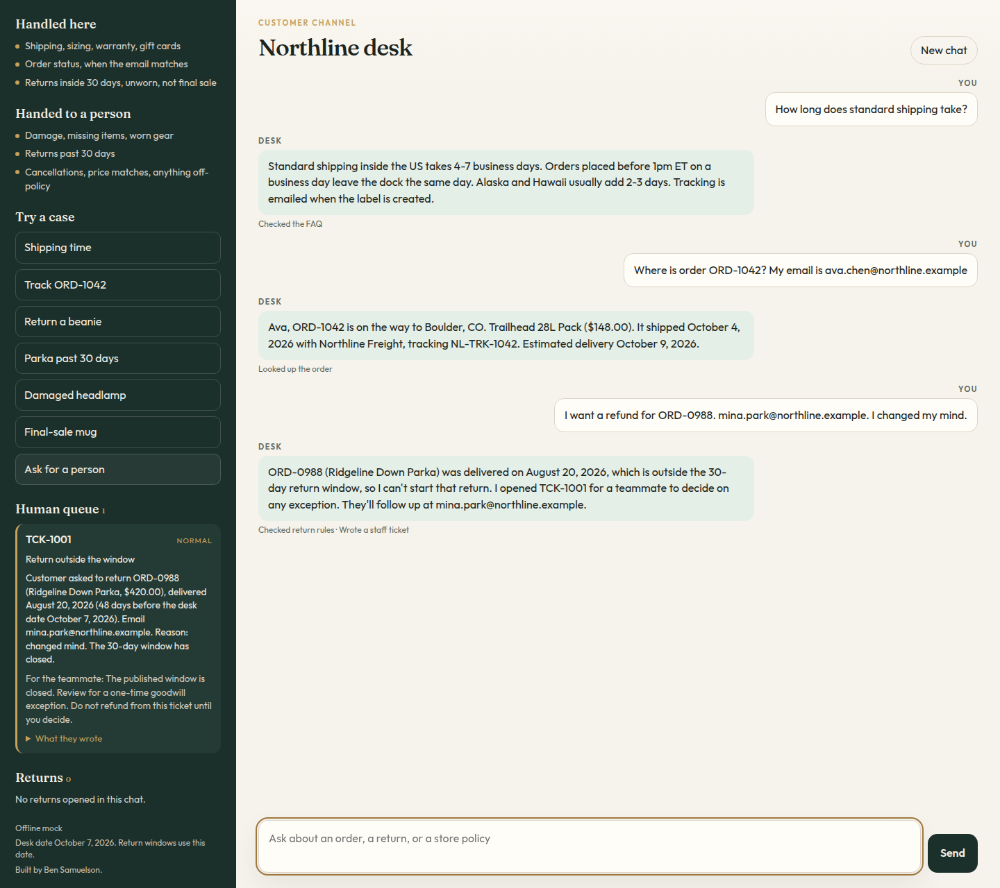

# AI automation portfolio

I'm Ben Samuelson. I build AI automation for small teams: workflows that file a new lead, a website chat that answers from your own pages, cleaned lead lists, and a phone receptionist that can book a visit or hand the call to a person.

I have built AI support automation for a call center, so I plan for messy input, a failed step, and the caller who just wants a human. The businesses in these folders are fictional. Phone numbers use the 555 exchange.

## Demos

| Demo | Folder | Status |
| --- | --- | --- |
| n8n lead intake | [n8n-lead-intake](n8n-lead-intake/) | Ready |
| Website chatbot | [website-chatbot](website-chatbot/) | Ready |
| Lead list scraper | [lead-list-scraper](lead-list-scraper/) | Ready |
| Voice receptionist | [voice-receptionist](voice-receptionist/) | Ready |
| Northline support agent | [northline-support-agent](northline-support-agent/) | Ready |

Python 3.12 and Node 22 are enough for the five ready demos. Run the test suites as separate commands. They share a few module names, so one combined pytest process will import the wrong file. `bash scripts/test-all.sh` already splits them.

## n8n lead intake

A website form becomes a hot, warm, or cold lead, a two-line summary, a Google Sheet row, a Gmail reply, and a Slack post when the lead is hot. The JSON file imports into n8n. The sample run on your machine does not need an n8n account or an API key.

```bash
cd n8n-lead-intake
python3 -m pip install -r requirements.txt
python3 simulate.py
python3 -m pytest -q tests
```

Open `n8n-lead-intake/samples/run-report.html` after the sample run.



## Website chatbot

Bright answers questions for BrightSmile Dental from 12 markdown pages. With no API key it quotes those pages. Set `OPENAI_API_KEY` and it sends the same notes to the model, then falls back to the quote if that call fails. Visitors can book a visit or ask for a person. Both show up on the front desk page.

```bash
cd website-chatbot
npm install
npm test
npm run dev
```

The site listens on [http://127.0.0.1:43123](http://127.0.0.1:43123). Desk: `/desk`. Question check: `/report`.







## Lead list scraper

Plumbers in Denver, collected from a local HTML directory that ships with the demo (the Front Range Business Index). The script normalizes phones, drops chain listings, and merges duplicate numbers. The sample CSV has 300 rows, each with a source and a collection date.

```bash
cd lead-list-scraper
python3 -m pip install -r requirements.txt
python3 scrape.py --date 2026-10-15
python3 -m pytest -q tests
```

Output: `lead-list-scraper/output/denver-plumbers.csv`.



## Voice receptionist

Peak Plumbing Denver, set up for Vapi or Retell: system prompt, tool definitions for booking and transfer, and a mermaid call flow. The text simulator walks scripted calls without placing a phone call. It will not book until the caller says yes.

```bash
cd voice-receptionist
python3 -m pip install -r requirements.txt
python3 simulate.py
python3 -m pytest -q tests
```

Open `voice-receptionist/samples/call-report.html`.



## Northline support agent

A support agent for Northline Supply, a fictional outdoor shop. It answers from a fixed FAQ, looks up an order when the email matches, opens a return inside 30 days, and writes a ticket when a person should decide. No API key is required. The folder README has the measured eval: 14 resolved of 22, and 22 of 22 labeled correctly.

```bash
cd northline-support-agent
python3 -m pip install -r requirements.txt
python3 -m pytest -q
python3 -m support_agent.eval
python3 -m support_agent.webapp --mock
```

The desk listens on [http://127.0.0.1:8741](http://127.0.0.1:8741).


